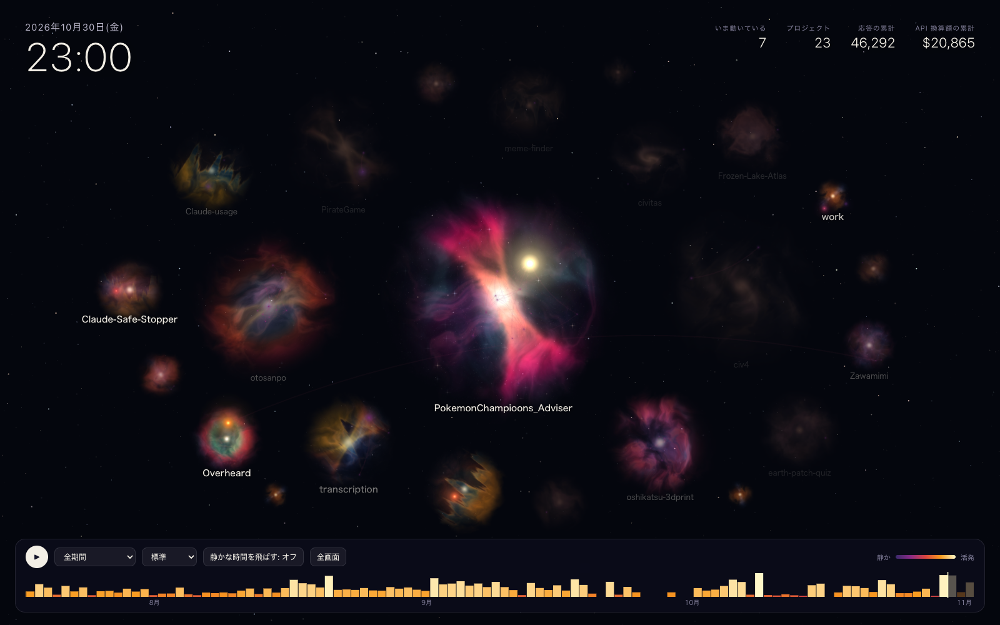
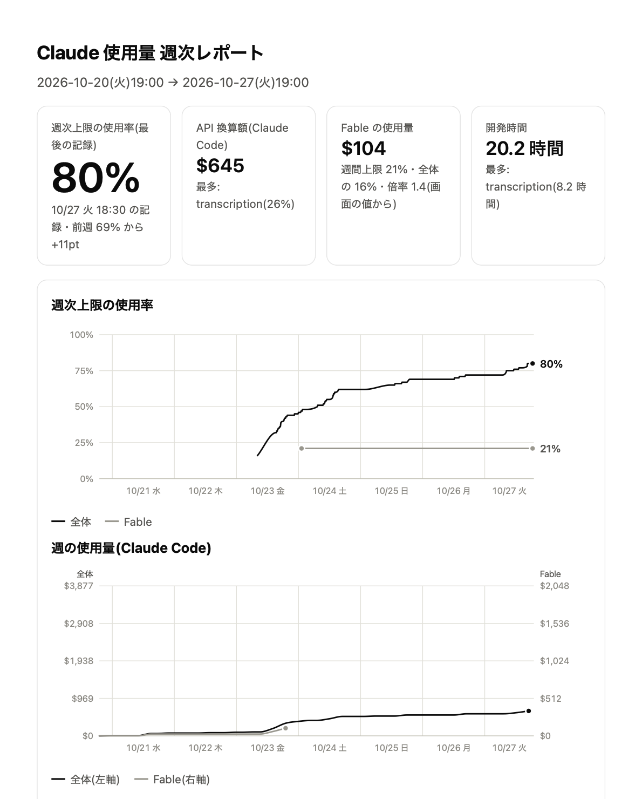
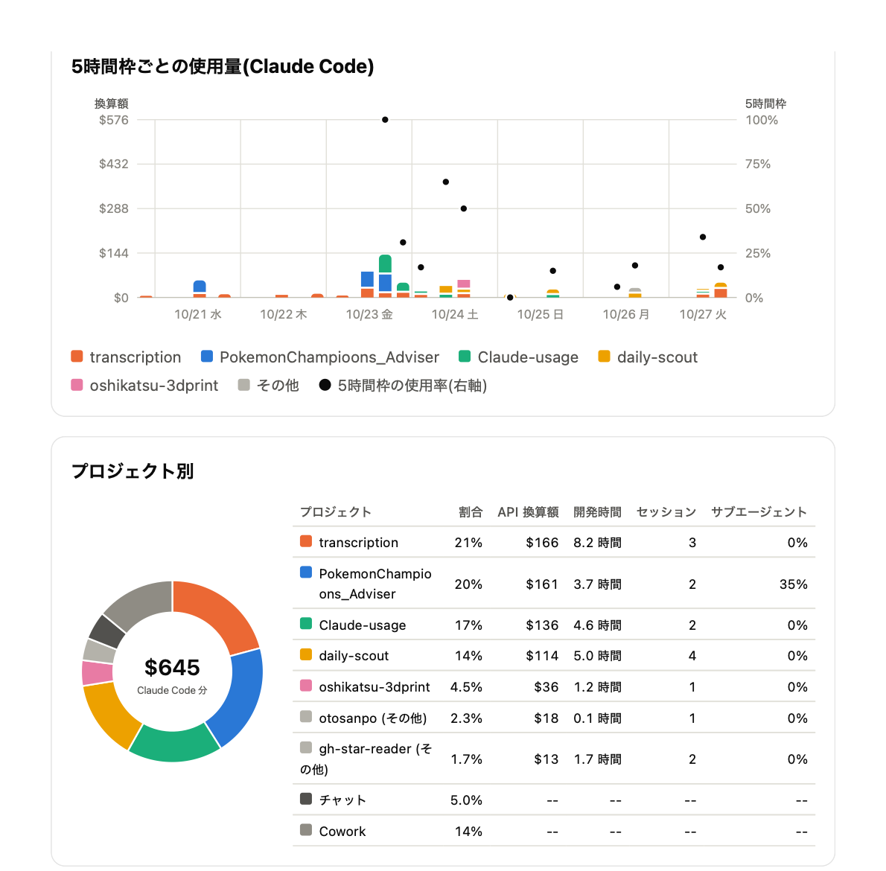

# Claude 使用量レポート

Claude Code の使用量を、毎週の PDF レポートと、全期間の活動を星雲として再生する画面にまとめる macOS 向けの小さなアプリです。
手元のログだけを読み、外部のサービスには何も送りません。

**再生画面のデモ:** [kentarotabe.github.io/Claude-usage](https://kentarotabe.github.io/Claude-usage/)(作者の実際の記録。2026-07-17〜11-03)



画面写真とデモは、作者の実際の記録から作ったものです。

## できること

### 毎週のレポート(PDF)

週次の使用上限がリセットされた直後に、終わった 1 週間分を PDF にして `~/Documents/Claude_Usage` に保存し、macOS の通知で知らせます。

- 週次上限の使用率の推移(全体と Fable)
- 週の使用量の累積と、5 時間枠ごとの使用量・使用率
- プロジェクト別の割合・API 換算額・開発時間・セッション数
- Claude Code 以外の利用(チャット・Cowork)の割合

| 1 ページ目 | 2 ページ目 |
|---|---|
|  |  |

### 活動の再生画面(HTML)

全期間の Claude Code の活動を、暗い宇宙に浮かぶ星雲として再生します。

- プロジェクトは星雲、セッションは星です。応答が多いほど星が明るく光ります(紫 → 赤 → 橙 → 白)。
- 関係のあるセッション(続きのセッション・同じ PR・同じブランチ・同じファイル)は線で結ばれ、近くに置かれます。
- 星雲の姿はプロジェクトごとに違います。作っているもの(フォルダのファイルの種類から推定)と使い方から連続的に決まり、
  生まれたては似た姿で、使うほど育ち、しばらく使わないと褪せていきます。
- 全期間・週ごと・時間軸で選んだ範囲を再生できます。配置は記憶し、週 1 回(週次リセットの後)新しい記録を足して作り直します。

## 仕組み

| 取得元 | 読むもの |
|---|---|
| Claude Code の会話ログ(`~/.claude/projects/**/*.jsonl`) | 応答ごとのトークン数・モデル・作業ディレクトリ・時刻 |
| デスクトップアプリの使用量の記録(`plan-usage-history.json`) | 週次・5 時間枠の使用率 |
| Claude Code の `/usage` の値 | 週次・Fable の使用率、製品別の内訳(定期実行のたびに問い合わせて記録) |

- 会話の本文は読みません。
- 使用量は「API 換算額」(トークン数 × API の単価 × モデルの倍率)で表します。実際の請求額ではなく、
  サブスクリプションの上限の減り方を近似したものです。
- Python の標準ライブラリだけで動きます。PDF への変換には、macOS 標準の WebKit を使う Swift の小さなヘルパーを初回にビルドします。
- 定期実行は launchd(30 分ごと)です。データベースも常駐プロセスも持ちません。

調査の記録・判断の理由・仕様の詳細は [docs/design.md](docs/design.md) にあります。

## 注意

- 個人用に作ったもので、作者の macOS の環境でだけ確かめています。
- デスクトップアプリの内部のファイルや Claude Code の内部の仕組みなど、公開された仕様ではないものに依存しています。
  アプリの更新で動かなくなることがあります。
- Anthropic の公式のツールではありません。

## 動かし方

必要なもの: macOS、Python 3.12、Xcode のコマンドラインツール(PDF 変換のヘルパーのビルドに使う)、Claude Code

```bash
git clone https://github.com/KentaroTabe/Claude-usage.git
cd Claude-usage
scripts/cu demo-report --pdf
```

設定は `config/config.example.toml` を `~/Library/Application Support/claude-usage/config.toml` に写して変えます
(なければ例のファイルを使います)。

| コマンド | 役割 |
|---|---|
| `scripts/cu report` | 終わった週のうち、まだ作っていない週のレポートを作る(`--all` ですべて作り直す、`--week YYYY-MM-DD` でその週だけ) |
| `scripts/cu demo-report [--pdf]` | ダミーデータで見た目を確認する |
| `scripts/cu activity [--open]` | 活動の再生画面を作る |
| `scripts/cu tick` | 定期実行の 1 回分(`/usage` の記録・未作成の週のレポート・再生画面の作り直し・通知) |
| `scripts/cu compare-sources` | 週次の使用率の 2 つの取得元(デスクトップアプリ・`/usage`)を照合する |
| `scripts/cu schedule [--apply \| --remove]` | launchd の設定内容を表示する(`--apply` で適用、`--remove` で外す) |

テストは `scripts/test` で実行します(外部の環境なしで動きます)。

## ライセンス

[MIT](LICENSE)
